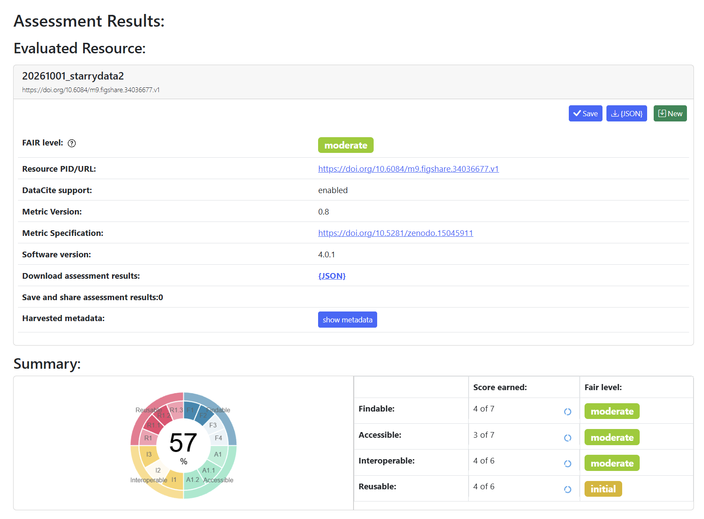

# FAIR Assessment and Metadata Record (Before Clean up)

**Dataset:** Starrydata dataset snapshot  
**Version DOI:** [10.6084/m9.figshare.34036677.v1](https://doi.org/10.6084/m9.figshare.34036677.v1)  
**Dataset files:** `starrydata_papers.csv`, `starrydata_samples.csv`, `starrydata_curves.csv`  
**Assessment prepared by:** Project Group "Data-Managers", SRH University of Applied Sciences Heidelberg  
**Assessment date:** 5 November 2026  
**License:** Creative Commons Attribution 4.0 International (CC BY 4.0)  
**Assessment method:** Manual review of the dataset record and its documentation, supplemented by the group’s F-UJI assessment.

## 1. Dataset and metadata record
 
Starrydata contains data digitized from figures in materials science publications. Its files describe papers, material samples, and curves. The documented schema uses `SID` to link papers, samples, and curves, and `sample_id` to relate samples and curves. Some fields contain JSON-encoded data, including sample descriptors and curve point arrays.

The Figshare DOI identifies this specific dataset version, supporting reproducible citation. The dataset record and accompanying documentation provide citation information; the paper and curve records also include bibliographic identifiers such as DOI.

| Metadata element | Record |
|---|---|
| Title | `20261001_starrydata2` (title of the Figshare record; informally "Starrydata dataset snapshot") |
| Creators | Tomoya Mato, Masaya Kumagai, Yukari Katsura (NIMS) |
| Repository | Figshare |
| Version DOI | 10.6084/m9.figshare.34036677.v1 (cite as `.v1`) |
| Posted on Figshare | 2026-09-30 21:00 (Figshare display time) |
| Database snapshot timestamp | `2026-10-01 02:00:01 UTC+0900 (JST)`, which is 2026-09-30 17:00:01 UTC (`db_snapshot.txt`) |
| Retrieval date | 2026-11-02 (download of `starrydata_dataset.zip`, 56.12 MB, 09:22:11 CET) |
| Data files | `starrydata_papers.csv` (56,495 rows); `starrydata_samples.csv` (106,331 rows); `starrydata_curves.csv` (237,313 rows) |
| Data format | CSV, with some JSON-encoded fields |
| License | CC BY 4.0 |
| Domain | Materials science. The README names thermoelectric, battery, and magnetic materials; the data carries 14 project labels (for example dielectric and piezoelectric), and thermoelectric is the largest (67% of curves). |
| Citation | Cite the version DOI and the Starrydata publication: Y. Katsura, M. Kumagai, T. Mato, et al., "Starrydata: from published plots to shared materials data", *Sci. Technol. Adv. Mater.: Methods* 5(1), 2506976 (2025), <https://doi.org/10.1080/27660400.2025.2506976>. |

## 2. FAIR assessment

Scores use **Satisfied**, **Partially satisfied**, and **Failed**. They describe the dataset and its documentation as assessed by the group; they are not a substitute for the F-UJI report.
**F-UJI evidence**
### F-UJI - FAIR Assessment Summary

 
| Item | Value |
|---|---|
| Tool | F-UJI web interface, software version 4.0.1 |
| Metric version | 0.8 (specification: <https://doi.org/10.5281/zenodo.15045911>) |
| **URL tested (resource PID)** | **`https://doi.org/10.6084/m9.figshare.34036677.v1`** |
| Resource title shown by F-UJI | `20261001_starrydata2` |
| DataCite support | enabled |
| Overall result | **57%, FAIR level "moderate"** |
| Run date | 05.11.2026 |
| Evidence files | Screenshot: `docs/evidence/fuji_assessment_summary.png`  JSON export: `docs/evidence/fuji_assessment.json`* |
 

 
| FAIR Principle      | F-UJI score earned | F-UJI level | Manual review  |
|---------------------|-------------|------------|------------|
| Findable (F)        | 4 of 7      | Moderate   | 2 satisfied, 2 partially satisfied |
| Accessible (A)      | 3 of 7      | Moderate   | 3 satisfied, 1 partially satisfied |
| Interoperable (I)   | 4 of 6      | Moderate   | 3 partially satisfied |
| Reusable (R)        | 4 of 6      | Initial    | 1 satisfied, 2 partially satisfied |
| **Overall**         | **57%**     | **Moderate** | n/a  |

### Findable

| Sub-criterion | Score | Justification |
|---|---|---|
| F1 — The data is assigned a globally unique and persistent identifier. | **Satisfied** | The Figshare snapshot has a version-specific DOI: `10.6084/m9.figshare.34036677.v1`. |
| F2 — The data is described with rich metadata. | **Partially satisfied** | The record provides citation metadata, and the files include paper, sample, and curve fields, but the completeness of domain-specific metadata needs further evaluation.
| F3 — Metadata clearly includes the identifier of the data it describes. | **Satisfied** | The DOI identifies the specific snapshot described by the Figshare metadata. |
| F4 — Metadata is registered or indexed in a searchable resource. | **Partially  Satisfied** | The dataset is discoverable through Figshare, but additional indexing and search-engine discoverability should be verified. |

### Accessible

| Sub-criterion | Score | Justification |
|---|---|---|
| A1 — Data can be retrieved using a standard communications protocol. | **Satisfied** | The public Figshare record and files are retrievable through the web using HTTPS. |
| A1.1 — The protocol is open, free, and universally implementable. | **Satisfied** | HTTPS is an open, widely supported protocol and does not require proprietary access software. |
| A1.2 — The protocol allows authentication and authorization where necessary. | **Satisfied** | The snapshot is publicly accessible without authentication; authentication is not required for this dataset. |
| A2 — Metadata remains accessible even if the data is no longer available. | **Partially satisfied** | The DOI provides a persistent record, but long-term metadata availability should be considered separately from file availability. |

### Interoperable

| Sub-criterion | Score | Justification |
|---|---|---|
| I1 — The data uses a formal, accessible, shared, and broadly applicable language for knowledge representation. | **Partially satisfied** | CSV and JSON are open, machine-readable formats, but the files do not appear to express their data model through a formal semantic framework such as RDF. |
| I2 — The data uses vocabularies that follow FAIR principles. | **Partially satisfied** | 	The schema documents domain-specific fields and SI-style unit notation, but the group has not identified mappings to shared, controlled materials-science vocabularies for all properties and descriptors. The notation is not controlled: one unit, siemens per metre, is written in three ways in unit_y: ohm^(-1)*m^(-1) (22,260 curves, electrical conductivity), S*m^(-1) (2,137 curves, all log(...) or ln(...) conductivity, see O24) and S/m (16 curves, Conductivity) (tracker O29). Property names are free text as well: 170 distinct prop_y values, for example Seebeck coefficient, thermopower and S for the same quantity. Equivalent units and names therefore have to be mapped by the user. Evidence: unit_notations.csv and appendix_b_prop_y.csv, produced by dictionary_appendix_counts.py. |
| I3 — The data includes qualified references to other data. | **Partially satisfied** | DOI, SID, and sample_id fields link records to their source papers and to each other, and every curve resolves to a sample. The links are not fully intact: 40 rows reference papers that are not in the dataset, namely 9 sample rows and 31 curve rows, all pointing to the same 3 SIDs (8534, 8535, 9026), about 0.01% of each table. Evidence: 01_data_profiling.ipynb (referential integrity report; tracker O6, O7, O19). |

### Reusable

| Sub-criterion | Score | Justification |
|---|---|---|
| R1.1 — The data is released with a clear and accessible data usage license. | **Satisfied** | The dataset is licensed under CC BY 4.0, as confirmed by Dr. Mato. |
| R1.2 — The data is associated with detailed provenance. | **Partially satisfied** | Citation metadata and links to original papers provide provenance, but users may need additional extraction and curation details to reproduce every digitized value. |
| R1.3 — The data meets domain-relevant community standards. | **Partially satisfied** | The dataset documents its tables, fields, relationships, and units, but its CSV/JSON schema is not fully mapped to a shared community data model. |

## 3. Summary

The overall F-UJI result is moderate (57%). Findability and accessibility are the strongest parts, but F-UJI rates both only "moderate" (4 of 7 and 3 of 7): the snapshot has a version DOI and is publicly retrievable through HTTPS, while metadata richness, indexing and long-term metadata availability are only partly established. Interoperability is moderate (4 of 6): CSV and JSON are machine-readable, but units and property names are not controlled (one unit appears in three notations) and 40 child rows reference papers that are absent. Reusability is initial (4 of 6): the CC BY 4.0 license is stated on the Figshare record and citation metadata exist, but the README license placeholder, limited provenance detail and a schema not mapped to a community model hold it back. These statements describe the dataset before any clean-up and do not claim FAIR compliance.

## 4. Evidence and references

- Figshare dataset snapshot: <https://doi.org/10.6084/m9.figshare.34036677.v1>
- Starrydata download documentation and data schema: <https://starrydata.github.io/hp/en/manual/download/>
- F-UJI result screenshot: docs/evidence/fuji_assessment_summary.png; F-UJI JSON export: docs/evidence/fuji_assessment.json (to be added); F-UJI tool: https://www.f-uji.net/index.php; metric specification: https://doi.org/10.5281/zenodo.15045911
- Starrydata citation guidance: <https://starrydata.github.io/hp/cite/>
- Orphan records (I3): 01_data_profiling.ipynb, referential integrity report
- Y. Katsura, M. Kumagai, T. Mato, et al., Sci. Technol. Adv. Mater.: Methods 5(1), 2506976 (2025): https://doi.org/10.1080/27660400.2025.2506976
- License: CC BY 4.0

